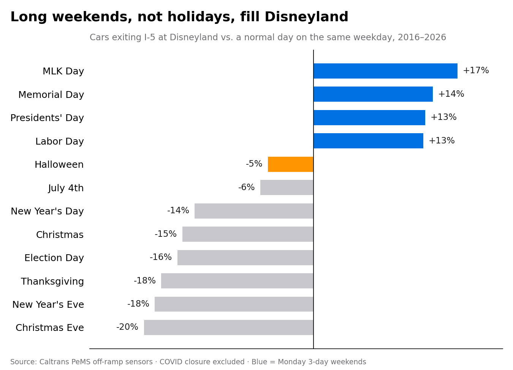
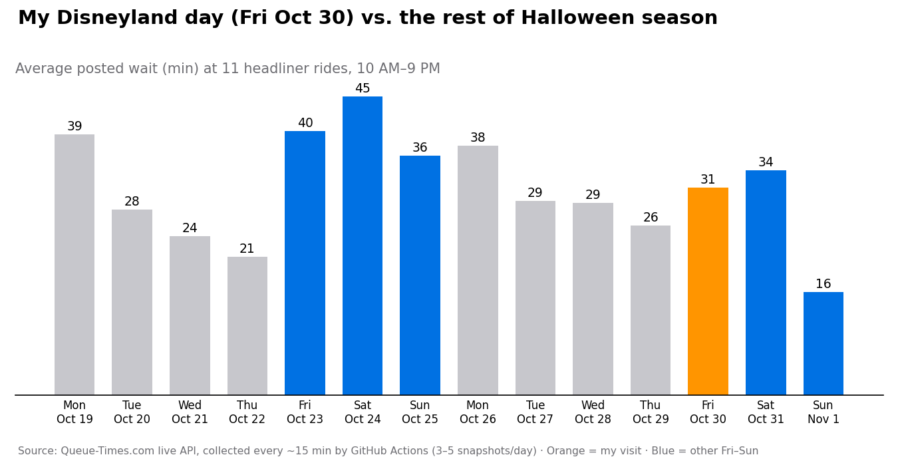
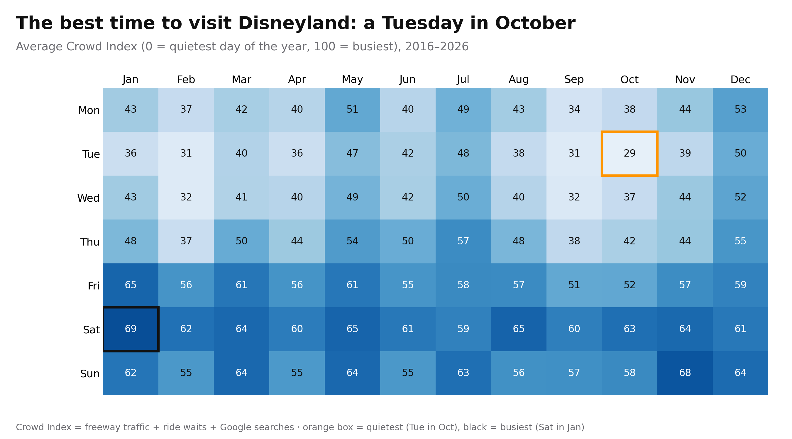
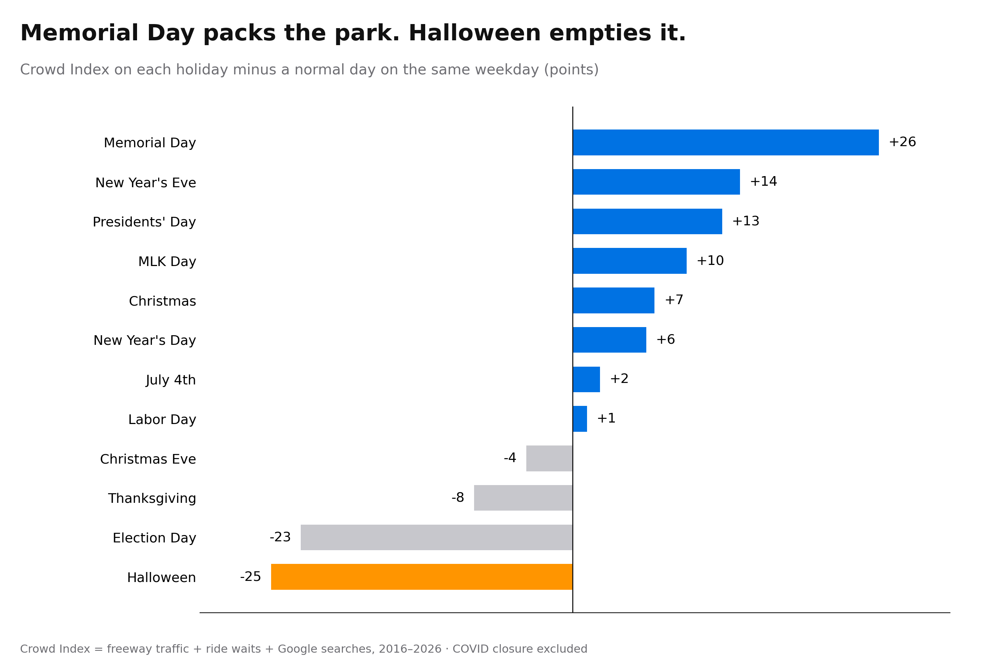
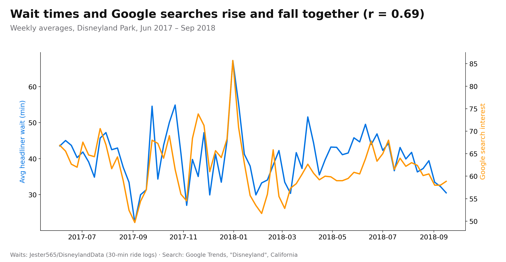
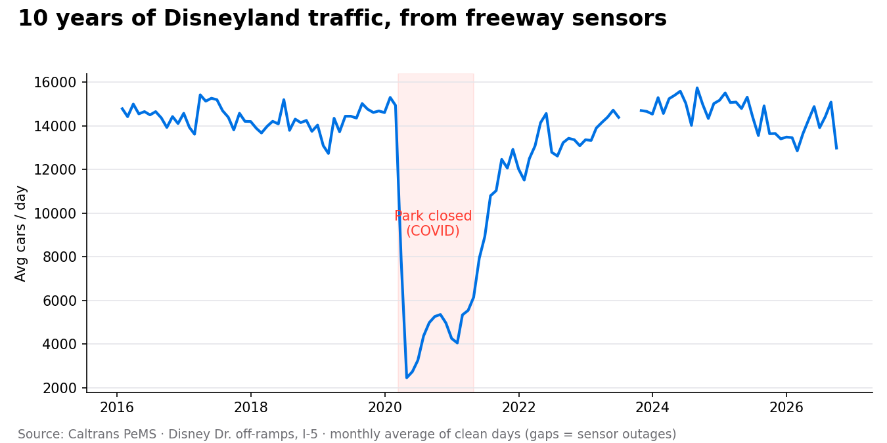

# How Crowded Is Disneyland, Really?

Disney doesn't publish daily attendance. This project rebuilds it from **three independent public signals** and checks whether they agree:

| Signal | Source | What it measures |
|---|---|---|
| 🚗 Freeway traffic | Caltrans PeMS sensors on the I-5 Disneyland off-ramps | When people **drive in** |
| ⏱️ Ride wait times | [Queue-Times.com](https://queue-times.com/) daily crowd level + live ride waits | How **packed** it is inside |
| 🔍 Search interest | Google Trends, "Disneyland", California | When people **plan** a trip |

The three are combined into a daily **Crowd Index (0–100)**.

> Status: complete · 📊 **[Interactive dashboard on Tableau Public](https://public.tableau.com/views/disneyland_crowd_index/DisneylandCrowdIndex)**

---

## Key findings so far



- **Long weekends, not holidays, fill Disneyland.** Monday holidays draw +13% to +17% more cars than a normal Monday (MLK Day +17%).
- **Family holidays empty out.** Christmas Eve −20%, Thanksgiving −18%, Election Day −16%, Halloween −5%.
- **Halloween 2026 spot check:** headliner waits on Fri Oct 30 averaged **31 min vs 40 min** the Friday before (−22%), and Halloween Saturday ran **34 vs 45 min** (−25%).



### The Crowd Index (all three signals combined)



- **Best time to go: a Tuesday in October** (Crowd Index 29). Worst: a Saturday in January (69).
- **Weekends dominate:** Saturday averages 63 and Tuesday 39.
- **Holidays ranked** (points vs a normal same weekday): Memorial Day **+26**, New Year's Eve +14, Presidents' Day +13 … Election Day **−23**, Halloween **−25**.



### Do the signals agree?

- **Wait times and Google searches move together** week to week (r = 0.69).
- **Traffic agrees with waits month to month** (r = 0.62) but is noisy week to week, because the off-ramps also carry hotel guests and staff.





---

## Method

1. **Clean the traffic data** (`notebooks/01_explore_pems.ipynb`): 129 monthly PeMS files (2016–2026) → the two Disneyland off-ramp sensors → 3,243 days where both sensors reported 100% of the day.
   *A sensor outage in July 2024 made traffic look like it fell 93%; missing data is not zero, so incomplete days are dropped.*
2. **Holiday analysis in PostgreSQL** (`sql/01_holiday_analysis.sql`): joins, CTEs, and a **same-weekday baseline**, since weekends are naturally ~20% busier than midweek.
3. **Wait times** (`src/scrape_queue_times.py`): 10 years of Queue-Times daily pages; live 15-minute snapshots via GitHub Actions (`src/collect_live.py`).
4. **Crowd Index** (`src/build_crowd_index.py`): each signal → percentile **within its calendar year** → equal-weight average. Ranking within each year removes long-term drift (search interest has slowly fallen since 2016, which first made 2020 look like the busiest year ever). Holiday effects are reported in index points vs the same weekday.
5. **Charts** (`src/part2_charts.py`) and **Tableau workbook** (`src/make_tableau.py` → `tableau/disneyland_crowd_index.twb`).

**Caveats:** off-ramps also carry hotel and park staff, so traffic is a proxy, not a turnstile count. Disneyland was closed 2020-03-14 to 2021-04-29 (excluded). Live wait data has only 3–5 snapshots/day. Historical wait times cover 2017–2018 only, so most days use 2 of the 3 signals.

## Repo layout

```
data/            cleaned datasets (raw PeMS files are git-ignored)
notebooks/       01_explore_pems.ipynb — traffic cleaning
sql/             01_holiday_analysis.sql — PostgreSQL analysis
src/             scrapers, live collector, Crowd Index builder, charts
figures/         charts used here and on LinkedIn
tableau/         Tableau Public workbook + extracts
```

## Reproduce

```bash
pip install -r requirements.txt
python3 src/scrape_queue_times.py --start 2016-01-01 --end 2026-10-31 --park 16
python3 src/build_crowd_index.py
python3 src/visit_week.py
python3 src/part2_charts.py
python3 src/make_tableau.py
```

## Data credit
Traffic: [Caltrans PeMS](https://pems.dot.ca.gov/) · Wait times: [Powered by Queue-Times.com](https://queue-times.com/) · Search: Google Trends

Built by Manny Sodhi · Python (pandas, matplotlib) · PostgreSQL · Tableau
